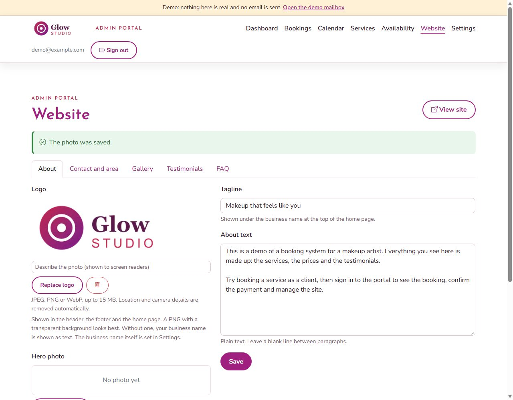

# Branding

This repository ships with **no real business's brand**. There is no logo file and no business name in the code: a fresh install shows the neutral name "Your Business" and a plain favicon. Each business brings its own name and logo, and sets them in the owner's portal, so they are stored in that business's own database and uploads and never in Git.

## Make it yours

Sign in to the portal (`/admin/`) and:

| What | Where | Used in |
| --- | --- | --- |
| **Business name** | Settings, "Your business" | The header and footer, page titles, and every email (the sign-off too) |
| **Logo** | Website, About tab, "Logo" | The header, the home page and the private booking page. A PNG with a transparent background looks best. Without a logo the business name is shown as text |
| **Tagline** | Website, About tab | The footer and the home page |
| **Contact, banking, social links** | Settings and Website | Emails, the booking page, the home page |

There is nothing to edit in the code. Changes show on the site within a minute.

| Before | After |
| --- | --- |
|  |  |
|  | |

## A little more

- **Favicon:** replace [`public/images/brand/favicon-64.png`](public/images/brand/favicon-64.png) with a 64 px PNG of your own. It is the one brand file in the repository, and it is neutral.
- **Colours and fonts:** the look is set in [`public/css/tokens.css`](public/css/tokens.css) (the colours, the fonts and the Bootstrap theme). Change the values there; [`docs/style-guide.md`](docs/style-guide.md) explains each one, and the contrast checks in the tests tell you if a new colour is too faint to read.
- **Wording:** the emails are in [`src/notifications/`](src/notifications/), the page text in [`public/`](public/).

## Keeping it neutral

An automated check (`src/common/brand-neutral.spec.ts`) fails if a business name, a first name or a logo file is added to the shipped code, so the repository stays free of anyone's brand.

## About "Make Up by Glory"

The project was built around a real business, **Make Up by Glory**. That name, its logo and its look are the property of its owner, Glory Mabunda, and are **not** covered by this repository's MIT licence, wherever they appear (including earlier versions of the repository and the written documents, which describe that business as the example). The licence covers the code. Please use your own name and logo.
