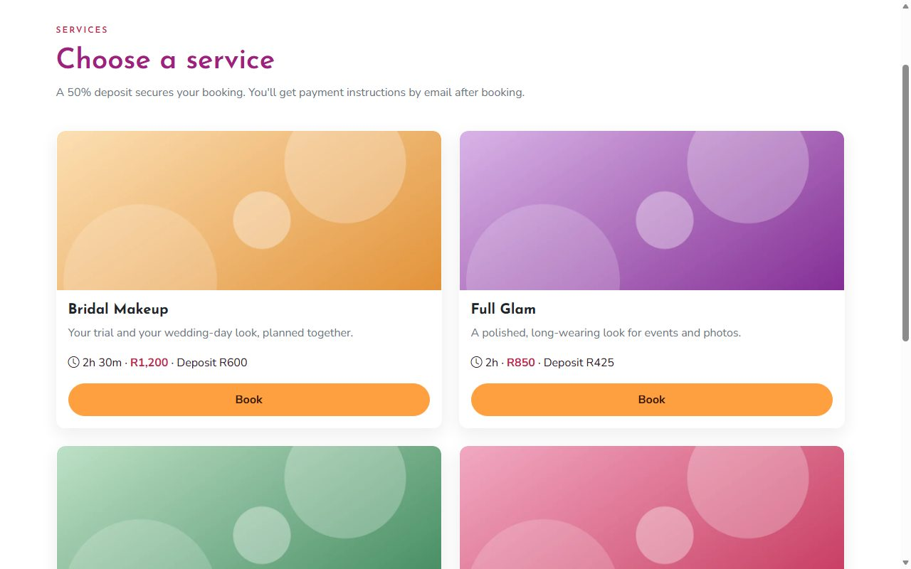
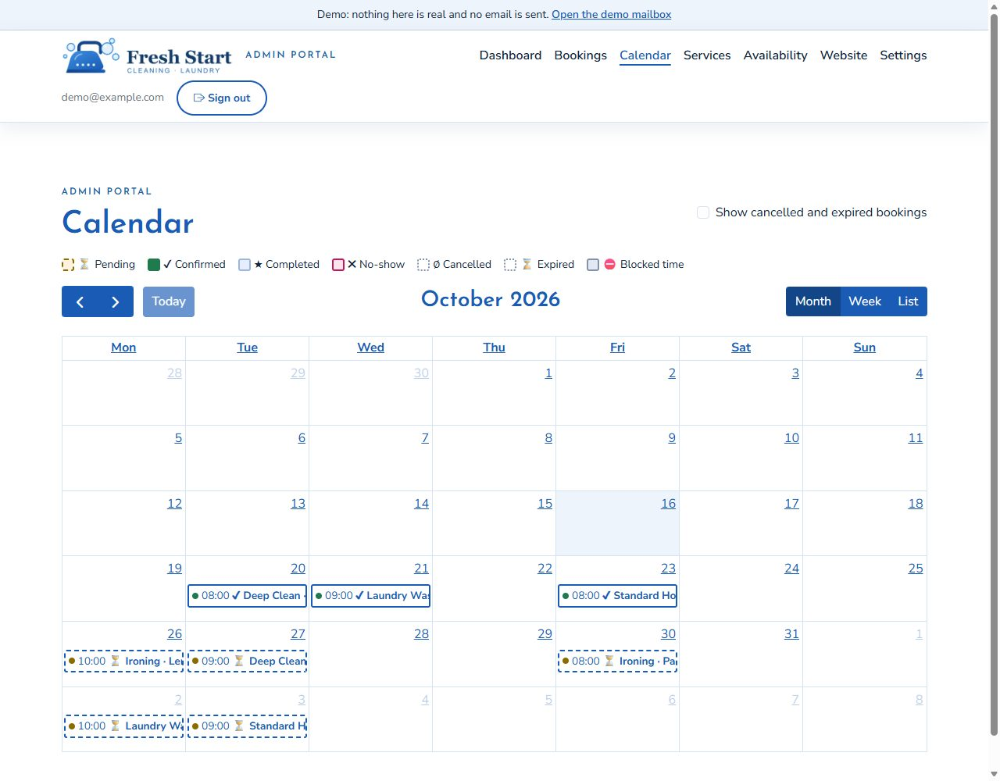
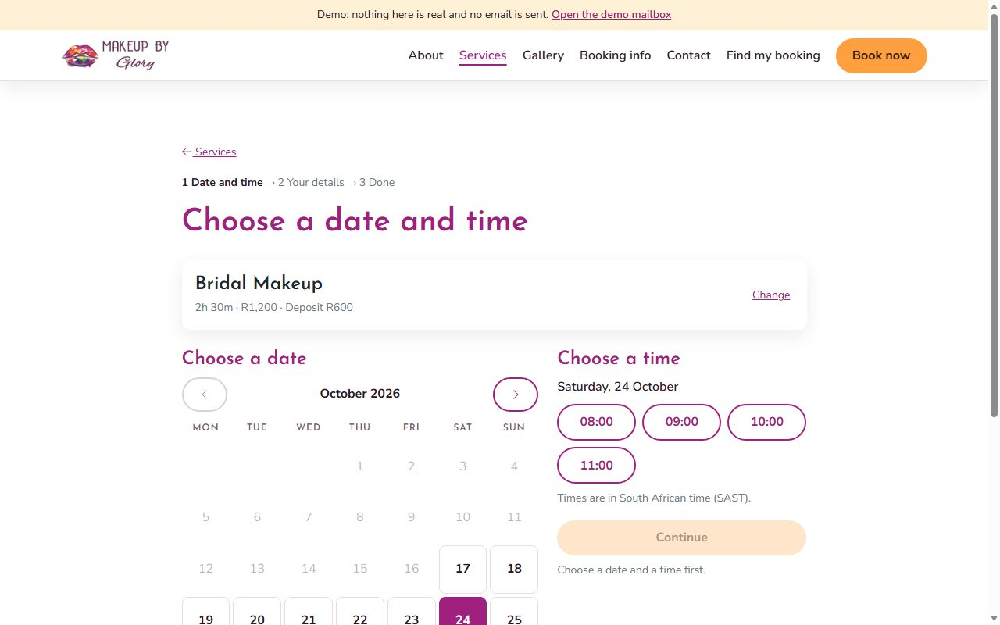
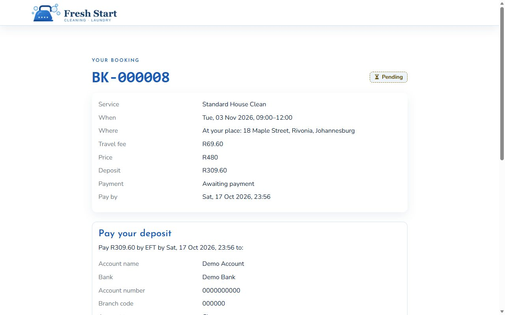
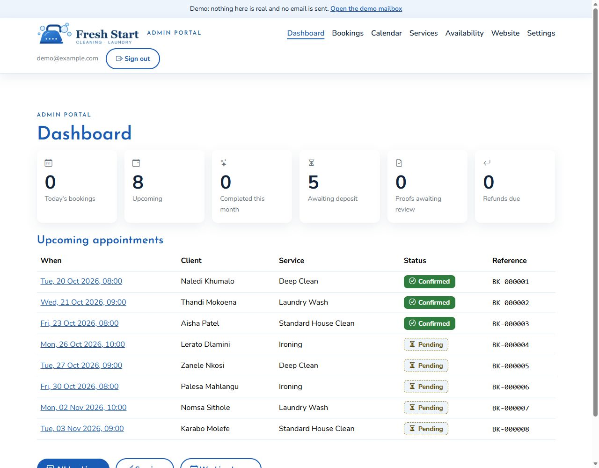
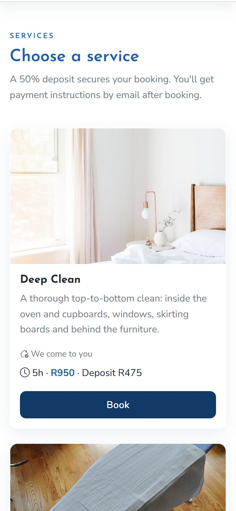
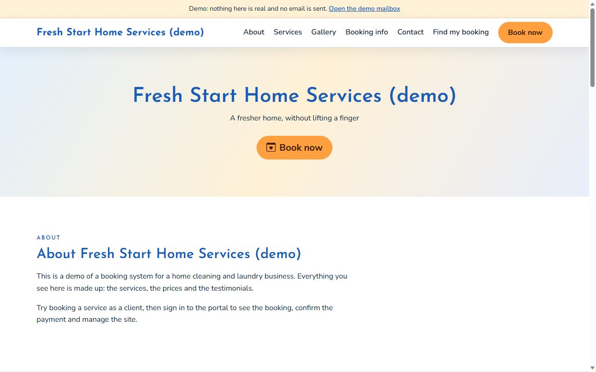
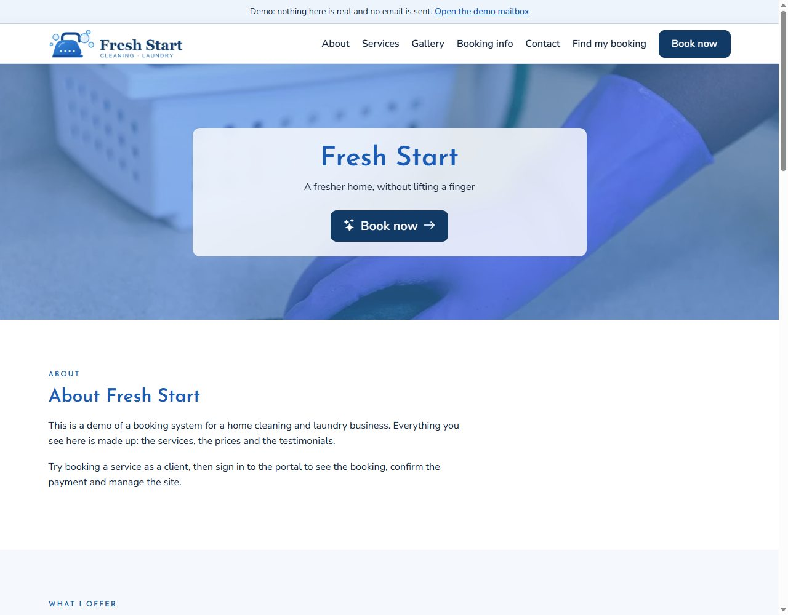

# Service Booking System 💄

[](https://github.com/GloryMabunda/Service-Booking-Marketplace/actions/workflows/ci.yml)

> **An appointment booking and management system designed for service-based businesses, allowing clients to discover services, view availability, book appointments online and secure them with a deposit.**

For this portfolio project the system is built around an example **home cleaning and laundry business**, but the booking logic is generic: a different appointment-based business (hair stylist, photographer, tutor, personal trainer) changes configuration, not code, including its own name and logo, set in the portal ([BRANDING.md](BRANDING.md)).

<p align="center">
  
  
</p>

## 🚀 Quick start: try it with one command

You only need [Docker](https://www.docker.com/products/docker-desktop/):

```bash
docker compose -f compose.demo.yml up --build
```

Then open <http://localhost:3000>. It starts the app and PostgreSQL, creates the tables and fills them with made-up demo data. Sign in to the owner's portal at <http://localhost:3000/admin/> as `demo@example.com` with the password `demo-admin-1234`. The demo sends no email: the emails it would send appear on the [demo mailbox](http://localhost:3000/demo-mailbox.html) page. If port 3000 is already in use, start it on another one, for example `DEMO_PORT=3001 docker compose -f compose.demo.yml up --build` (PowerShell: `$env:DEMO_PORT=3001; docker compose …`). More in [docs/demo.md](docs/demo.md).

---

## ✨ What it does

**For clients**, no account needed:

- Browse services as cards with pictures, prices, durations and deposits
- Pick a date and a time that is really free, at the owner's place or (for services that allow it) at their own place with a travel fee worked out from their address
- Book, pay a deposit by EFT, and upload a proof of payment from a phone, through a private booking link in their email
- Look up or cancel a booking, with a clear refund rule

**For the owner**, in a secure portal:

- A dashboard, a calendar and a booking list; review proofs of payment and confirm a payment only once the money is in the bank
- Services (with pictures), working hours, blocked time, deposit and refund rules, travel fees and banking details
- A website editor for the home page: About text, photos, gallery, testimonials and FAQ

| | |
| --- | --- |
|  |  |
| *Choose a date and a time that is really free* | *The private booking page: pay the deposit, upload a proof, or cancel* |
|  |  |
| *The owner's dashboard* | *Built mobile first* |

**Your brand, not ours.** The project ships with a neutral name and no logo. The owner sets the business name in Settings and uploads a logo under Website, and the header, footer, home page and every email follow, with no code to change. See [BRANDING.md](BRANDING.md).

| | |
| --- | --- |
|  |  |
| *Out of the box: the name as text* | *After uploading a logo (a sample one here)* |

More screens: the [demo mailbox](docs/images/demo-mailbox.jpg), [bookings](docs/images/admin-bookings.jpg), [one booking](docs/images/admin-booking.jpg), [services](docs/images/admin-services.jpg), [website editor](docs/images/admin-website.jpg).

## 🛠️ Built with

| | |
| --- | --- |
| **Backend** | Node.js 24, TypeScript, NestJS 12, Kysely, zod |
| **Database** | PostgreSQL 17, with migrations |
| **Frontend** | Plain HTML and JavaScript, Bootstrap 5, FullCalendar |
| **Quality** | Vitest (more than 1,500 unit and integration tests on a real database), ESLint, Prettier, axe accessibility checks, GitHub Actions CI |
| **Running it** | Docker, Docker Compose, Caddy |

## 🧠 Engineering highlights

- **No double bookings, even under load.** A PostgreSQL exclusion constraint makes two overlapping bookings impossible, and a test fires parallel requests at it.
- **Money without surprises.** Deposits and travel fees are worked out in whole cents on the server, and each booking keeps a snapshot of the price and rules it was made with.
- **Private by design.** Booking links are random tokens that are stored only as hashes, never logged and never shown on screen; client details stay out of logs; uploads are checked from their content, not their name.
- **Hardened and accessible.** Content security policy and other browser headers, rate limits, automated secret scanning, and WCAG checks on every page (docs: [security](docs/security.md), [accessibility](docs/accessibility.md)).
- **Honest about failure.** If an email, a map lookup or a migration fails, the app says so and keeps the data safe; a deploy that fails stops without touching the running version.
- **Documented before built.** Specification, database design, API, wireframes, style guide and email wording all live in [`docs/`](docs/).

## 🧪 Run it for development

```bash
npm install
npm run db:up        # PostgreSQL in Docker
npm run db:migrate
npm run seed:admin   # creates the owner's account from ADMIN_EMAIL and ADMIN_PASSWORD in .env
npm run start:dev    # http://localhost:3000
```

Copy `.env.example` to `.env` first. On Windows PowerShell use `npm.cmd`. The full steps, the everyday commands and troubleshooting are in [docs/development.md](docs/development.md).

## 📚 Documentation

| | |
| --- | --- |
| 📖 [Case study](docs/case-study.md) | The product, the flows, the modules and the plan in full |
| 📄 [Specification](docs/specification.md) | The requirements; where anything differs, the specification wins |
| 🗄️ [Database](docs/database.md) · 🔌 [API](docs/api.md) · 🖼️ [Wireframes](docs/wireframes/README.md) · 🎨 [Style guide](docs/style-guide.md) · ✉️ [Emails](docs/emails.md) | Design |
| 🔐 [Security and POPIA](docs/security.md) · ♿ [Accessibility](docs/accessibility.md) | Protection and checks |
| 🧭 [Travel fees](docs/travel.md) · 🎭 [Demo](docs/demo.md) | Features |
| 🚢 [Hosting](docs/hosting.md) · [Deployment](docs/deployment.md) | Going live |

## 🚧 Status

Built, tested and waiting to go live. Everything up to the security, accessibility and testing milestone is merged; deployment (a server, a domain and an email provider) is the remaining step. Details in the [case study](docs/case-study.md#-project-status).

## 🤝 Contributing

Every change goes through an issue, a branch and a pull request that passes CI. See [`CONTRIBUTING.md`](CONTRIBUTING.md).

## 📜 Licence

MIT for the code. See [`LICENSE`](LICENSE). The project ships with a neutral brand: your business name and logo are set in the portal, never in the code. The name and logo of the example business, Make Up by Glory, are not covered by the licence. See [`BRANDING.md`](BRANDING.md).
